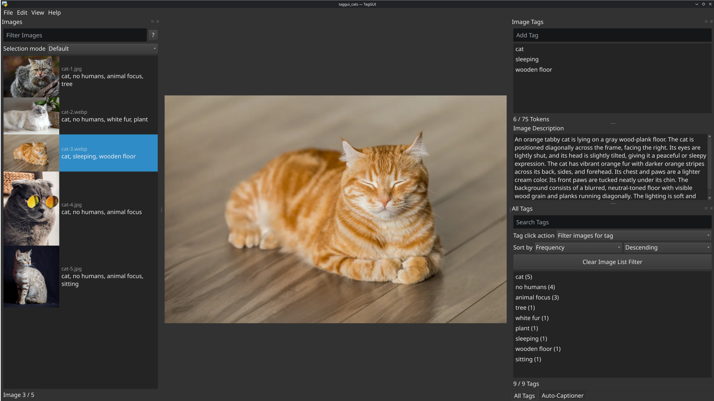
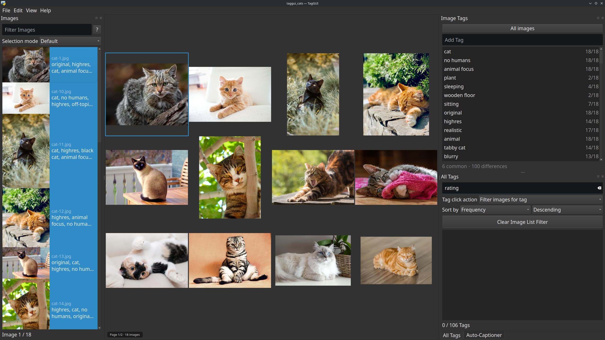
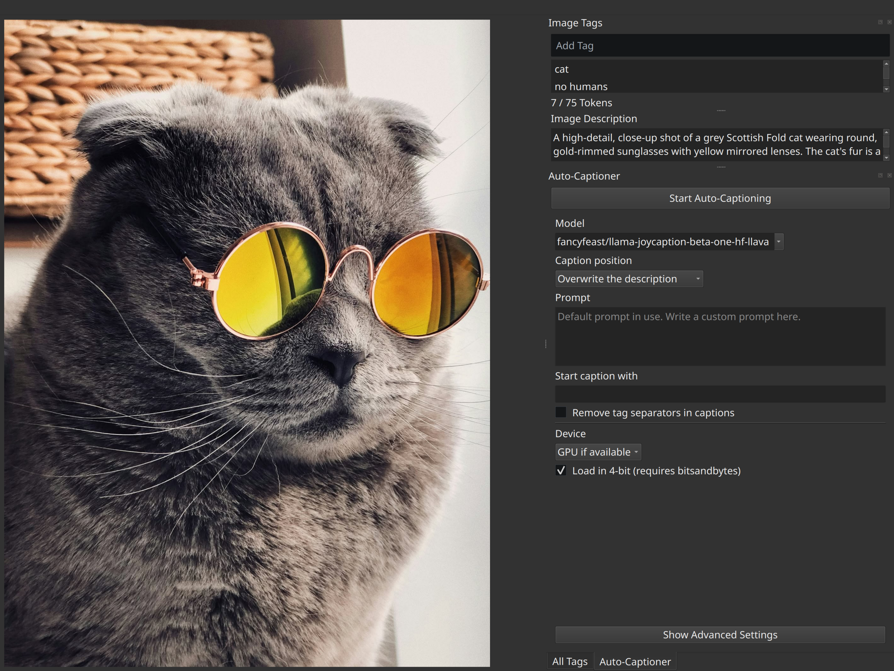

# TagGUI

Cross-platform desktop application for quickly adding and editing image tags
and captions, aimed towards creators of image datasets for generative AI
models.

## Features

- Keyboard-friendly interface for fast tagging
- Tag autocomplete based on your own most-used tags
- Integrated token counter (for Stable Diffusion)
- Automatic caption and tag generation
- Description box for free-form, natural language image descriptions
- Tags and descriptions stored in a local SQLite database by default (or in
  classic `.txt` caption files), so tags follow each image across folders
- Caption models that run on llama.cpp, including Gemma 4 31B and Qwen 3.8 27B
- Batch tag operations for renaming, deleting, and sorting tags
- Tagging near-identical (variant) images together, with a synchronized grid preview
- Advanced image list filtering

## Installation

The easiest way to use the application is to download the latest release from
the [releases page](https://www.github.com/jhc13/taggui/releases).
Choose the appropriate file for your operating system, extract it wherever you
want, and run the executable file inside.
You may have to install [7-Zip](https://www.7-zip.org/download.html) to
extract the files if you don't have it on your system.

- macOS users: There is no macOS release because it requires a device running
  the OS, and I do not have one. You can still install and run the program
  manually (see below).
- Linux users: You may need to install `libxcb-cursor0`.
  (See [this Stack Overflow answer](https://stackoverflow.com/a/75941575).)

Alternatively, you can install manually by cloning this repository and
installing the dependencies in `requirements.txt`.
Run `taggui/run_gui.py` to start the program.
Python 3.12 is recommended, but Python 3.11 should also work.

## Usage

Load the directory containing your images by clicking the `Load Directory`
button in the center of the window (or `File` -> `Load Directory`).
By default, tags and descriptions are loaded from, and saved to, a local
SQLite database (see [Tag and description storage](#tag-and-description-storage)).
You can also store them in `.txt` files next to the images instead.

### Image Description

Each image also has an `Image Description` box in the `Image Tags` pane,
below the tag list.
It is intended for free-form, natural language descriptions that do not need
to be divided into tags.
Descriptions are saved automatically together with the tags: in the database
by default, or, in text-file storage mode, in the same `.txt` file as the tags
(the tags first, then a blank line, then the description).
You can also direct generated captions into the description by choosing one
of the description options in the `Caption position` setting in the
Auto-Captioner pane (for example, `Overwrite the description`).

## Tagging variant images

Many datasets contain **sets of near-identical images** — the same base picture
with small differences (a changed expression, color, or accessory).
TagGUI has a dedicated workflow for tagging these together instead of one at a time.

When you **select two or more images** (with the feature enabled in
**`Settings`**, which it is by default), the `Image Tags` pane and the center
preview switch to a multi-image mode:

- **Synchronized grid preview** — the center preview shows every selected image
  in a single grid that shares one zoom and pan, so you can line up the same
  detail across all of them at once. The **current** image has a **highlight
  outline**; use `Left` / `Right` (or `Up` / `Down` at the top/bottom of the
  tag list) to move the current image through the selection without changing
  selected images. Clicking a cell also makes that image current.
  - If the selection is bigger than **`Max grid cells for multi-image
    preview`** (default `12`), the grid is split into pages of that many cells,
    and cycling the current image walks through the current page before moving
    on to the next. A small overlay in the corner of the preview shows the
    total number of images, and the current page when there is more than one
    (for example, `Page 2/3 · 25 images`); you can hide it and adjust its text
    size and background transparency in `Settings`.
- **Grouped `Image Tags` pane** — the pane shows a single combined tag list,
  but each tag now carries a **`k/N` badge** for how many of the `N` selected
  images have it:
  - **`Common`** tags are on **every** selected image (the badge reads `N/N`).
  - **`Differences`** tags are on **some but not all** of them (`k/N`, with `k`
    below `N`). Selecting a Differences tag **dims the grid images that don't
    have it**, so the ones that do stand out. Hover an image to brighten it
    briefly, or — for keyboard use — **hold `Ctrl`** to brighten the current
    image while you decide whether to add the tag to it.

A **scope toggle** at the top of the pane controls where the `Add Tag` box
adds tags:

- **`All images`** (default) — tags go to **all selected images**.
- **`Current image only`** (the button highlights) — tags go to just the
  **current** (outlined) image, so you can adjust one variant without touching
  the rest.

You can also **right-click a tag** in the grouped list to copy it, or *Add to*
/ *Remove from* **all selected** images or **the current image**, applying a
tag to either scope without changing the toggle (each action is only offered
when it would do something). Pressing `Delete` removes the selected tags from
all selected images. The normal list behaviors apply too: double-click (or
`F2`) to rename, and select several tags with `Ctrl`/`Shift`+click to apply
them at once.

The grouped list behaves like the normal tag list: tags keep a **stable
position** as you edit, so removing a tag from one image only updates its
`k/N` count instead of reshuffling the list. Newly added tags go to the end,
renamed tags keep their position (if the rename merges into a tag that was on
only some of the images, that tag moves to the place of the tag you renamed),
and undo/redo puts tags back exactly where they were.

At the bottom of the pane, the **`X common · Y differences` counts** double as
**filters**: click `common` to show only the tags on every selected image,
click `differences` to show only the ones that differ, and click the active
one again to show everything. Choosing `differences` also switches the scope
toggle to **`Current image only`**, and `common` switches it back to
**`All images`**, so the `Add Tag` scope matches what you're looking at.

> [!NOTE]
> - In multi-image mode the `Image Description` box and the token counter are
>   hidden, since they apply to a single image.
> - You can turn this off (and always keep the single-image view) with
>   **`Settings` → `Group tags & show grid when multiple images are selected`**
>   (on by default).
> - **`Max grid cells for multi-image preview`** caps how many images are
>   drawn in the grid at once (default `12`, range `4`–`64`), so large
>   selections are split into pages.
> - **`Show grid page/count overlay`** (together with the overlay's text size
>   and background transparency) controls the small page/count label in the
>   grid preview.

## Automatic Captioning

In addition to manual tagging, you can automatically generate captions or tags
for your images inside TagGUI.
GPU generation requires a compatible NVIDIA GPU, and CPU generation is also
supported.

To use the feature, select the images you want to caption in the image list,
then select the captioning model you want to use in the Auto-Captioner pane.
If you have a local directory containing previously downloaded models, you can
set it in `File` -> `Settings` to include the models in the model list.
Click the `Start Auto-Captioning` button to start captioning.
You can select multiple images to batch generate captions for all of them.
It can take up to several minutes to download and load a model when you first
use it, but subsequent generations will be much faster.

In addition to the Hugging Face models, TagGUI supports caption models that
run on [llama.cpp](https://github.com/ggml-org/llama.cpp) (via
llama-cpp-python).
These models are downloaded automatically from Hugging Face as GGUF files on first use,
or loaded from a local model directory (set in `File` -> `Settings`) that
contains the model file and its vision projector file.

TagGUI also supports tagger models, which generate a list of tags (rather than
a free-form caption) for each image: the [WD Tagger family](https://huggingface.co/SmilingWolf) and the
[PixAI Tagger](https://huggingface.co/pixai-labs/pixai-tagger-v1.0).
Tagger output is stored as tags using the same tag separator as manual tags.

### Unloading the model

Captioning models are large, and while a model is loaded it occupies RAM or
VRAM that you might want back for something else.
The small **up-arrow button** next to the `Start Auto-Captioning` button
ejects the model from memory, freeing its RAM/VRAM, without closing the
Auto-Captioner pane.
The button is only enabled while a model is loaded and no captioning run is in
progress, and the console reports `Model unloaded from memory.` once the
unload is done.
The next time you start captioning, the model has to be loaded again, so that
run starts with the model-load delay.
Closing the Auto-Captioner pane or quitting TagGUI unloads the model as well.

### Captioning parameters

`Prompt`: Instructions given to the captioning model.
Prompt formats are handled automatically based on the selected model.
You can use the following template variables to dynamically insert information
about each image into the prompt:

- `{tags}`: The tags of the image, separated by commas.
- `{name}`: The file name of the image without the extension.
- `{directory}` or `{folder}`: The name of the directory containing the image.

An example prompt using a template variable could be
`Describe the image using the following tags as context: {tags}`.
With this prompt, `{tags}` would be replaced with the existing tags of each
image before the prompt is sent to the model.

`Start caption with`: Generated captions will start with this text.

`Remove tag separators in caption`: If checked, tag separators (commas by
default) will be removed from the generated captions.

`Discourage from caption`: Words or phrases that should not be present in the
generated captions.
You can separate multiple words or phrases with commas (`,`).
For example, you can put `appears,seems,possibly` to prevent the model from
using an uncertain tone in the captions.
The words may still be generated due to limitations related to tokenization.

`Include in caption`: Words or phrases that should be present somewhere in the
generated captions.
You can separate multiple words or phrases with commas (`,`).
You can also allow the captioning model to choose from a group of words or
phrases by separating them with `|`.
For example, if you put `cat,orange|white|black`, the model will attempt to
generate captions that contain the word `cat` and either `orange`, `white`,
or `black`.
It is not guaranteed that all of your specifications will be met.

Tagger models (the WD Tagger family and the PixAI Tagger) have their own set
of options:

`Show probabilities`: If checked, the console output shows each tag's
probability.

`Maximum tags`: The maximum number of tags to generate for an image.

`Tags to exclude`: Tags that should not be generated, separated by commas.

WD Tagger models use a single `Minimum probability` threshold: a tag is only
included if its probability is at least that value.

The PixAI Tagger uses per-category thresholds instead, available in the
advanced settings: `PixAI general threshold`, `PixAI character threshold`,
`PixAI style threshold`, `PixAI copyright threshold`, `PixAI meta threshold`,
and `PixAI rating threshold`.
A tag is only included if its probability is greater than the threshold for
its category.
The defaults are the recommended settings from the model card.

llama.cpp models (such as Gemma 4 31B) have their own set of generation
parameters in the advanced settings: `Seed` (use `-1` for a random seed),
`Maximum tokens`, `Temperature`, `Top-k`, `Top-p`, and `Repetition penalty`.

Many of the other generation parameters are described in the
[Hugging Face documentation](https://huggingface.co/docs/transformers/main/en/main_classes/text_generation#transformers.GenerationConfig).

## Advanced Image List Filtering

The basic functionality of filtering for images that contain a certain tag is
available by clicking on the tag in the `All Tags` pane.
In addition to this, you can construct more complex filters in
the `Filter Images` box at the top of the `Images` pane.

Click here to see the full documentation for the filter syntax.

### Filter criteria

These are the prefixes you can use to specify the filter criteria you want to
apply:

- `tag:`: Images that have the filter term as a tag
    - `tag:cat` will match images with the tag `cat`.
- `caption`: Images that contain the filter term in the caption
    - The caption is the list of tags as a single string, the tags joined by
      the tag separator.
    - `caption:cat` will match images that have `cat` anywhere in the
      caption. For example, images with the tag `orange cat` or the
      tag `catastrophe`.
- `desc`: Images that contain the filter term in the description
    - The description is the free-form, natural language image description in
      the `Image Description` box.
    - `desc:cat` will match images whose description contains `cat` anywhere.
      For example, an image with the description "A cat sitting on a table".
- `name`: Images that contain the filter term in the file name
    - `name:cat` will match images such as `cat-1.jpg` or `large_cat.png`.
- `path`: Images that contain the filter term in the full file path
    - `path:cat` will match images such as `C:\Users\cats\dog.jpg` or
      `/home/dogs/cat.jpg`.
- You can also use a filter term with no prefix to filter for images that
  contain the term in either the caption or the file path.
    - `cat` will match images containing `cat` in the caption or file path.

The following are prefixes for numeric filters. The operators `=` (`==` also
works), `!=`, `<`, `>`, `<=`, and `>=` are used to specify the type of
comparison.

- `tags`: Images that have the specified number of tags
    - `tags:=13` will match images that have exactly 13 tags.
    - `tags:!=7` will match images that do not have exactly 7 tags (images with
      less than 7 tags or more than 7 tags).
- `chars`: Images that have the specified number of characters in the caption
    - `chars:<100` will match images that have less than 100 characters in the
      caption.
    - `chars:>=30` will match images that have 30 or more characters in the
      caption.
- `tokens`: Images that have the specified number of tokens in the caption
    - `tokens:>75` will match images that have more than 75 tokens in the
      caption.
    - `tokens:<=50` will match images that have 50 or fewer tokens in the
      caption.

### Spaces and quotes

If the filter term contains spaces, you must enclose it in quotes (either
single or double quotes).
For example, to find images with the tag `orange cat`, you must
use `tag:"orange cat"` or `tag:'orange cat'`.
If you have both spaces and quotes in the filter term, you can escape the
quotes with backslashes.
For example, you can use `tag:"orange \"cat\""` for the tag `orange "cat"`.
An alternative is to use different types of quotes for the outer and inner
quotes, like so: `tag:'orange "cat"'`.

### Wildcards

You can use the `*` character as a wildcard to match any number of any
characters, and the `?` character to match any single character.
For example, `tag:*cat` will match images with tags like `orange cat`,
`large cat`, and `cat`.

### Combining filters

Logical operators can be used to combine multiple filters:

- `NOT`: Images that do not match the filter
    - `NOT tag:cat` will match images that do not have the tag `cat`.
- `AND`: Images that match both filters before and after the operator
    - `tag:cat AND tag:orange` will match images that have both the tag `cat`
      and the tag `orange`.
- `OR`: Images that match either filter before or after the operator
    - `tag:cat OR tag:dog` will match images that have either the tag `cat` or
      the tag `dog`, or both.

The lowercase versions of these operators will also work: `not`, `and`,
and `or`.

The operator precedence is `NOT` > `AND` > `OR`, so by default, `NOT` will be
evaluated first, then `AND`, then `OR`.
You can use parentheses to change this order.
For example, in `tag:cat AND (tag:orange OR tag:white)`, the `OR` will be
evaluated first, matching images that have the tag `cat` and either the
tag `orange` or the tag `white`.
You can nest parentheses and operators to create arbitrarily complex filters.

## Controls

- ⭐ Previous / next image: `Ctrl`+`Up` / `Down` (just `Up` / `Down` also works
  in some cases)
  - With two or more images selected, this selects a single image just before
    (respectively just after) the selection — the deliberate way to leave a
    multi-image selection. Plain arrows keep the current image inside the
    selection instead.
- Jump to the first untagged image: `Ctrl`+`J`
- Focus the `Filter Images` box: `Alt`+`F`
- Focus the `Add Tag` box: `Alt`+`A`
- Focus the `Image Tags` list: `Alt`+`I`
- Focus the `Search Tags` box: `Alt`+`S`
- Focus the `Start Auto-Captioning` button: `Alt`+`C`

### Images pane

- First / last image: `Home` / `End`
- Select multiple images: Hold `Ctrl` or `Shift` and click the images
- Select all images: `Ctrl`+`A`
- Invert selection: `Ctrl`+`I`
- Right-clicking on an image will bring up the context menu, which includes
  actions such as copying and pasting tags and moving or copying selected
  images to another directory.

### Image Tags pane

- Add a tag: Type the tag into the `Add Tag` box and press `Enter`
- ⭐ Add the first tag suggested by autocomplete: `Ctrl`+`Enter`
- Add a tag to multiple images: Select the images in the image list add
  the tag
- Delete a tag: Select the tag and press `Delete`
- Rename a tag: Double-click the tag, or select the tag and press `F2`
- Reorder tags: Drag and drop the tags
- Select multiple tags: Hold `Ctrl` or `Shift` and click the tags

### Multi-image (variant) view

With two or more images selected, the panes switch to the multi-image mode
described in [Tagging variant images](#tagging-variant-images):

- Cycle the current image within the selection: `Left` / `Right` (or
  `Up` / `Down` at the top/bottom of the tag list)
- Leave the selection: `Ctrl`+`Up` / `Down` selects a single image just
  before/after it
- Brighten the current image in a dimmed grid: Hold `Ctrl`
- Make a grid cell the current image: Click the cell
- Add or remove the selected tag(s) on one image: Right-click a grid cell

### All Tags pane

- Show all images containing a tag: Select the tag (When `Tag click action` is
  set to `Filter images for tag`)
- Add a tag to selected images: Click the tag (When `Tag click action` is set
  to `Add tag to selected images`)
- Delete all instances of a tag: Select the tag and press `Delete`
- Rename all instances of a tag: Double-click the tag, or select the tag and
  press `F2`

The `Edit` menu contains additional features for batch tag operations, such as
`Find and Replace` (`Ctrl`+`R`) and `Batch Reorder Tags` (`Ctrl`+`B`).

## Tag and description storage

By default, TagGUI stores each image's tags and description in a local SQLite
database file, rather than in a `.txt` file next to the image.
Images are identified by the **content** of the file (a hash of its bytes),
not by its name or location.
That means an image retrieves the same tags and description no matter which
folder you open it from, and renaming, moving, or copying the file does not
lose its tags.

Existing `.txt` caption files are not ignored: when an image has no record in
the database yet and a caption file sits next to it, its tags and description
are imported into the database automatically.
Importing is additive only — it never overwrites an existing record.

The storage mode and the database location can be changed in
`File` -> `Settings`:

- **`Tags and descriptions storage`** — `SQLite database` (the default) or
  `Text files next to images` (the classic behavior: one `.txt` file per
  image, with the tags first, then a blank line, then the description).
  Switching backends moves no data by default. The confirmation dialog offers
  a *Migrate and override* option, which imports the tags and descriptions of
  the currently loaded images into the database — or writes them to caption
  files, when switching to text files — overwriting the existing data for
  those images.
- **`Database location`** — by default, the database is created at:
  - Linux: `~/.local/share/taggui-describe/taggui-describe.sqlite3`
  - Windows: `%LOCALAPPDATA%\TagGUI-Describe\taggui-describe.sqlite3`
  - macOS: `~/Library/Application Support/TagGUI-Describe/taggui-describe.sqlite3`

  Choose a different location with `Select...` (or restore the default with
  `Default`).
  If a database already exists at the old location, it is moved to the new
  location; if one already exists at the new location, you choose whether to
  overwrite it with the old database or to keep the existing one.
- **`Clear Database...`** — permanently deletes all tags and descriptions
  stored in the database. The database file itself stays in place and remains
  usable, and your image files (and, in text-file storage mode, your `.txt`
  caption files) are not affected.
  Deleting the database file directly has the same effect on the stored data.

## Acknowledgments

The "tagging variant images" feature was developed with reference to code in
[taggui-plus](https://github.com/Overtime-Artist/taggui-plus#tagging-variant-images)
by Overtime-Artist.
